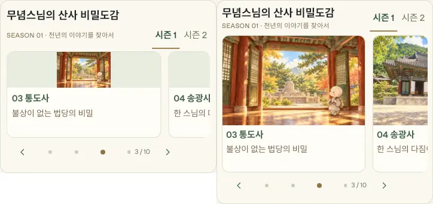

# 홈페이지 비밀도감 대표 이미지 복구 (2026-10-25)

최신 main `236c751` 기준. 아래 비교는 390px iPhone 크기 WebKit 에뮬레이션이며 왼쪽이 변경 전, 오른쪽이 변경 후입니다. 실기기 Safari 검사는 수행하지 않았습니다.

- 이미지: 60px contain → 모바일 135–150px cover, PC 160px cover. 390px에서는 150px.
- 카드 폭 제한과 제목·시즌 탭 배치, 여백 축소로 전체 높이는 290px → 342px(+52px). 대형 배너는 추가하지 않음.
- 기존 480×320 썸네일을 재사용. 정암사 탑 꼭대기는 개별 이미지 위치를 조절. 새로운 이미지·라이브러리·본문 선로딩 없음.
- 시즌 1·2 전체 20장 실제 카드 캡처를 비교. 건축물·무념스님과 하단 글씨를 확인. 특별편은 공통 스타일을 사용하는 테스트용 회차로 확인했으며 실제 회차 목록은 변경하지 않음.
- WebKit/Chromium 320·390·412·700·820·1440px에서 이미지 폭·높이, 잘림(원본 대비 7% 미만), 글씨 분리, 페이지 넘침, 시즌 전환·화살표, 108순례 바로 위 위치 및 보호용 로컬 기록 유지 검사.
- 서비스 워커는 캐시 이름만 갱신. Firebase·기존 회차·진행 기록·사진·GPS·108카드 로직 및 데이터는 수정하지 않음. 운영 계정 데이터 쓰기 테스트 없음.

검증 코드: `tests/atlas-home-images.cjs`, `atlas-home-catalog.cjs`, `atlas-season-switch.cjs`, `atlas-episodes.cjs`(carousel only), `mobile-navigation-worker.cjs`.
